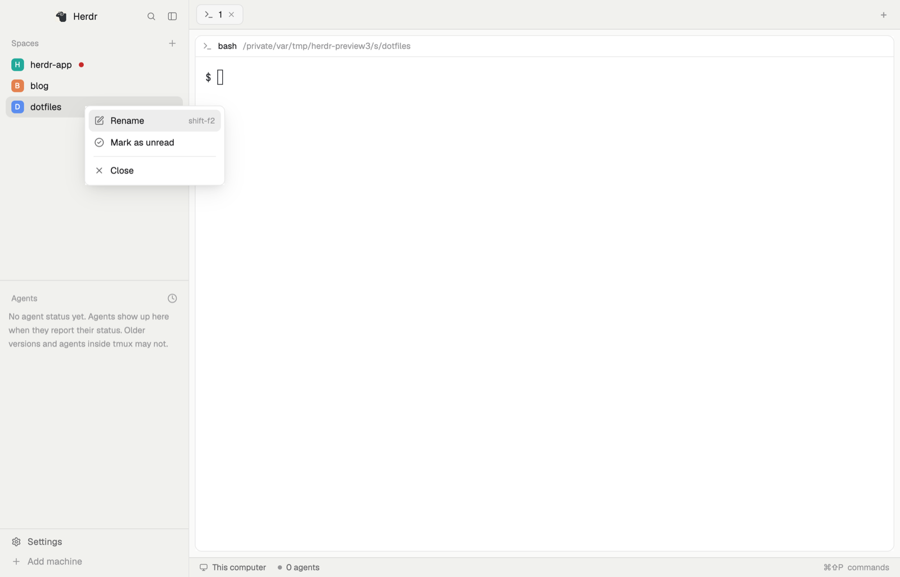

# herdr-mods

My [Herdr](https://herdr.dev) mods in one place, plus the layout that wires them
together on my machine. Each mod is also published on its own so it has an entry
on herdr.dev/mods; this repo is the whole set and the install that uses all of
them.

| Mod | What it adds | Also published as |
|---|---|---|
| [`spaces-rename`](mods/spaces-rename) | double-click a space in the sidebar to rename it | [herdr-spaces-rename](https://github.com/ceilf6/herdr-spaces-rename) |
| [`spaces-unread`](mods/spaces-unread) + [`spaces-unread-menu`](mods/spaces-unread-menu) | right-click a space to mark it unread: a red dot stays until you switch to it. Double-click rename included. | [herdr-spaces-unread](https://github.com/ceilf6/herdr-spaces-unread) |
| [`tabs-quick-close`](mods/tabs-quick-close) | the x on a space's last tab closes the space without the "Close space?" dialog | [herdr-tabs-quick-close](https://github.com/ceilf6/herdr-tabs-quick-close) |
| [`layouts/my-main.json`](layouts/my-main.json) | the layout on my machine: `spaces-unread` in the sidebar, `tabs-quick-close` at the top of the work area | — |



`spaces-rename` and `spaces-unread` replace the same block, and `spaces-unread`
already has the double-click rename, so a layout uses one or the other. Mine
uses `spaces-unread`.

The files under `mods/` are the same files as in those repos: they are copies,
not submodules, so a change to a mod has to be made in both places until the
individual repos are retired.

## Install

```sh
git clone https://github.com/ceilf6/herdr-mods
cp -R herdr-mods/mods/spaces-unread herdr-mods/mods/spaces-unread-menu \
      herdr-mods/mods/spaces-rename herdr-mods/mods/tabs-quick-close \
      ~/.config/herdr-app/mods/
herdr-app do layout.clone '{"name":"main","as":"my-main"}'
cp herdr-mods/layouts/my-main.json ~/.config/herdr-app/layouts/my-main.json
```

The window follows within a second; `ctrl-shift-l` switches layouts if you want
Herdr's own back. To use only part of it, point your own layout's `spaces` and
`tabs` blocks at the mod ids you installed instead of copying `my-main.json` —
`my-main.json` is a clone of Herdr 0.1.11's `main`, so a newer Herdr may have
changed the layout around it.

`herdr-app check ~/.config/herdr-app/mods/<mod>` should pass for each mod.

## What each one changes

Nothing here is a new feature in the app core. Every mod is a clone of a shipped
mod (`mod.json` records `cloned_from`) with a small change, so it goes stale
when Herdr's own copy moves on; the way to refresh is to re-clone the shipped
mod and re-apply the change listed in its recipe.

- [`docs/spaces-rename.md`](docs/spaces-rename.md) — Herdr 0.1.11's `spaces`,
  plus one line in `row()` that opens `space.rename` on a double-click.
- [`docs/spaces-unread.md`](docs/spaces-unread.md) — Herdr 0.1.11's `spaces`
  plus a dot drawn from shared storage `space.marks`, and 0.1.14's `menu` plus
  one item that toggles that mark. Marks survive restarts and clear when you
  switch to the space.
- [`docs/tabs-quick-close.md`](docs/tabs-quick-close.md) — Herdr 0.1.11's
  `tabs`, with the active tab's x passing `confirmed: true`. Mind that this is
  a safety net removed on purpose: one click ends every terminal in that space,
  agents included.

Each recipe is also a brief an agent can rebuild the mod from.

## Layout

`layouts/my-main.json` is Herdr's `main` layout with two blocks repointed:

- `sidebar-lists/spaces` → `spaces-unread`
- `work/tabs` → `tabs-quick-close`

Everything else (`workspace-chrome`, `agents`, `files`, `changes`,
`workspace-status`, `pane`) is the shipped mod as it is. Runtime state
(`shared.json`, `view.json`, `window.json`) is not part of this repo.

## Preview images

`previews/` holds one screenshot per mod, showing the block it replaces.
